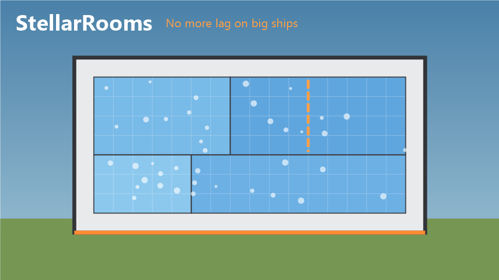

# Ship Performance Fix

A MelonLoader mod for **StellarDrive (Demo)**: no more freeze when you place or remove a hull panel on a big ship.



Part of the Stellar suite: [StellarAnchor](https://github.com/tidic84/StellarDrive-StellarAnchor) · [StellarBuild](https://github.com/tidic84/StellarDrive-StellarBuild) · [StellarFactory](https://github.com/tidic84/StellarDrive-StellarFactory) · [StellarLogistics](https://github.com/tidic84/StellarDrive-StellarLogistics). Ship Performance Fix works on its own.

## Why the game freezes

After every hull change, the game recomputes the ship's rooms: the closed air volumes that hold oxygen. To do that, it clears the air region around the change and floods it again through an octree of voxels. The air outside the hull is one region that wraps the whole ship. So every panel placed or removed against the outside walks the entire outside of the ship. Inside, a panel walks the whole room. With about 2,000 parts that takes 25 to 100 ms per change. It runs on the host, then again on every client.

## What it does

Ship Performance Fix produces the same rooms and volumes as the game without the full walks:

- **Panel against the outside:** the outside is never cleared. A flood that reaches the edge of the octree is outside and stops there.
- **Panel inside a room:** a flood starts from each side of the panel and stops as soon as the floods meet. If the room really is cut in two, only the piece cut off is walked and becomes a new room with the same air.
- **Panel removed:** the freed air joins the single room (or the outside) it touches.
- **Anything else** falls back to the game's own recompute, limited to the regions involved: a room opened to the outside, two rooms merged, or adds and removes in the same tick.

Measured on a 20 × 10 × 20 two-deck hull (about 2,000 panels), room update per change on each machine:

| Change | Game | Ship Performance Fix |
| --- | --- | --- |
| Panel against the outside | ~37 ms | < 1 ms |
| Panel inside a room | 15–30 ms | ~1 ms |
| Panel removed | 15–30 ms | ~1 ms |
| Room opened / closed | ~60 ms | 12–40 ms |

The hull mesh (3 to 8 ms) and colliders (~1 ms) are rebuilt by the game as before. They are chunked, so they do not grow with the ship.

**Air density.** The game counts every voxel the octree splits during an update as vacuum, so a room's air thins a little with each panel you place inside it. With Ship Performance Fix, a room keeps its density, and a hull closed in an atmosphere takes the atmosphere's density.

## Frame rate near big ships

Two things in the game cost every frame, and grow with the size of the ships around you:

- **Client colliders moved for nothing.** On each player's machine, a ship's colliders hang under a transform with no rigidbody, so PhysX treats them as static colliders. Every physics tick the game writes the ship's pose to that transform, even when the ship has not moved, and PhysX then moves every collider one by one. A 25,000-panel ship has about 20,000 of them. Ship Performance Fix writes the pose only when it changed (by more than 0.1 mm), so a parked ship, or the ship you stand in, costs nothing.
- **Ship bounds measured voxel by voxel.** Every frame, on the client and again on the host, the game looks for a ship the player could reposition and asks each ship for its bounds. The game answers by reading every voxel of every chunk of the ship. Ship Performance Fix keeps each ship's bounds and recomputes them only after a part is added, changed or removed.

Measured with two big ships landed on the same planet (25,746 and 69,021 panels), standing next to them:

| | Game | Ship Performance Fix |
| --- | --- | --- |
| Client ship physics, per frame | ~13 ms | < 1 ms |
| Ship bounds, per frame | ~12 ms | ~0 ms |
| Frame rate | ~32 fps | ~100 fps |

**With TF Advanced: force field doors.** TF Advanced animates the sheet of its force field doors on the CPU, recomputing the colour of every vertex every frame for every door within 30 m, on screen or not; a 27 × 23 door has about 28,000 vertices. Ship Performance Fix paints a door only while it is on screen, at most 30 times per second, and with a copy of the mod's paint that computes each point once for both faces of the sheet (the colours are identical, checked vertex by vertex). Inside the ship above, with two big doors: ~6.7 ms → ~0.9 ms per frame, and ~50 → ~80–100 fps. Nothing changes when TF Advanced is not installed.

**Big ships against the ground.** The host simulates each ship with sweep-based continuous collision detection (CCD), so that 0.1 m hull panels do not pass through the ground. On a big ship that means thousands of shapes swept against the terrain every physics tick, and it is worst when the ship moves along the ground. Ship Performance Fix switches ships of 1,000 parts or more to PhysX's speculative CCD, which keeps the ground solid by creating contacts ahead of the motion. A 25,746-panel ship pushed along the ground at 15 m/s on an i3-9100F: host physics ~20–30 ms → ~10–12 ms per tick, 10–15 → 14–24 fps. At rest it is cheaper too (~9.8 → ~7.6 ms per tick). Free flight away from the ground was already cheap and does not change.

The host's physics step is still the largest cost near big ships: about 6 ms per tick at rest with the two ships above on the faster PC.

## Joining a world with big ships

A player who joins receives every ship of the world in one message, about 17 bytes per hull panel. The Steam transport tells FishNet that a reliable message may hold 1 MB, so FishNet never splits it, but Steam refuses any message over 512 KB. Past roughly 30,000 panels in the world (one 26,000-panel ship is enough), the message is dropped and the joining player loads forever.

Ship Performance Fix caps reliable messages at Steam's 512 KB, so FishNet splits the world into pieces and the client puts them back together, and raises Steam's send buffer so the pieces queued in the same tick are not refused. **The host needs the mod** for this; clients may or may not have it.

## Install

With [Stellar Mod Manager](https://github.com/jollyname/StellarModManager), or extract `StellarDrive-ShipPerformanceFix.zip` into the game folder (MelonLoader 0.7.x).

Multiplayer: every machine computes its own rooms, so each player who installs it gets the gain on their own machine. Room ids never go over the network, and saves store the rooms by position, so players with and without the mod can play together.

## Building

```powershell
./build.ps1    # Release build + dist/StellarDrive-ShipPerformanceFix.zip
```

`dev.sh` / `cmd.sh` drive the game on this PC from WSL; `dev139.sh` / `cmd139.sh` do the same on another PC over SSH (`HOST`), starting the game in its logged-in session.

Override the game path with `-GamePath "D:\SteamLibrary\steamapps\common\StellarDrive Demo"`. Building with `-p:DefineConstants=DEV` adds dev commands read from `UserData/stellar_rooms_cmd.txt`, with timers on the room, mesh and collider updates. The commands are `bigship`, `addpart`, `rmpart`, `addbox`, `rooms`, `roomcheck`, `fuzz`, `vacuum`, `roomsfast on|off`, `prof on [ms]|off`, `spikes <ms>`, `frame <n> [updates]|watch [ms]` (time per player loop system and per Update), `scene`, `posefix on|off`, `boundscache on|off`, `boundscheck`, `doorfix on|off`, `doorcheck`, `push <ship> <up> <forward> <s>`, `where <ship>`, `near <ship> <m>`, `colsize`, `ccd on|off` and `load <world>`; see `RoomsDev.cs`.
